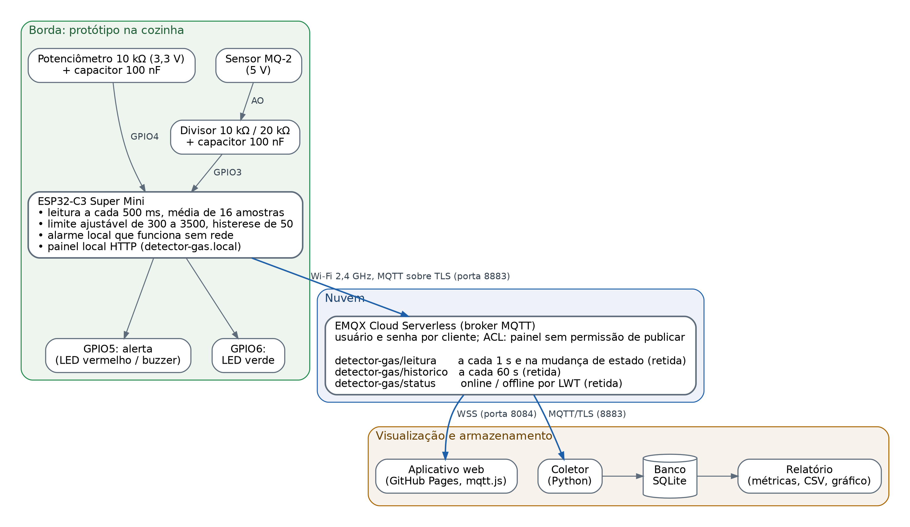
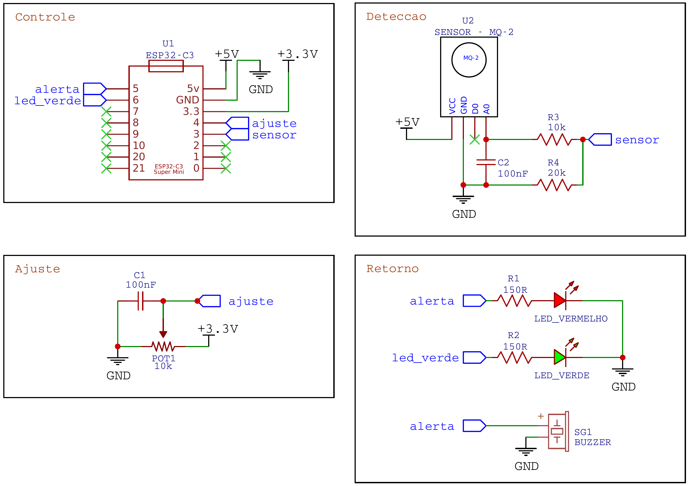

# Detector de gás com ESP32-C3, MQ-2 e MQTT

Protótipo da disciplina Internet das Coisas (UNDB). Detecta gases inflamáveis e fumaça com um sensor MQ-2, aciona um alarme local que funciona mesmo sem rede e envia as leituras por MQTT para um broker na nuvem, de onde um aplicativo web mostra os dados em tempo real e um coletor grava o histórico em banco de dados.



## Como funciona

1. O ESP32-C3 lê o MQ-2 a cada 500 ms (média de 16 amostras) e compara com um limite ajustado no potenciômetro (300 a 3500, com histerese de 50). Acima do limite, liga o alerta (GPIO5); abaixo, o LED verde (GPIO6). Essa parte roda numa tarefa própria e não depende do Wi-Fi.
2. Pelo Wi-Fi, o ESP32 publica no EMQX Cloud com TLS (porta 8883):
   - `detector-gas/leitura`: a cada 1 s e na mudança de estado, mensagem retida;
   - `detector-gas/historico`: as últimas 60 leituras, a cada 60 s, mensagem retida;
   - `detector-gas/status`: `online` ao conectar e `offline` pelo LWT (testamento), mensagem retida.
3. O aplicativo web (`docs/index.html`, publicado no GitHub Pages) assina esses tópicos por WebSocket seguro (WSS, porta 8084).
4. O coletor (`ferramentas/coletor.py`) assina os mesmos tópicos e grava tudo num banco SQLite. O `relatorio.py` calcula as métricas dos testes, exporta CSV e gera o gráfico.
5. O ESP32 também serve um painel local em `http://detector-gas.local` (ou pelo IP), para uso na mesma rede.

Formato da mensagem de leitura:

```json
{"id":"detector-01","seq":1532,"t":1793116800123,"v":412,"l":2000,"c":0}
```

| Campo | Significado |
| --- | --- |
| `id` | identificação do detector |
| `seq` | número sequencial da mensagem (volta a 0 quando a placa reinicia); lacunas indicam mensagens perdidas |
| `t` | hora da leitura em milissegundos desde 1970 (UTC), sincronizada por NTP |
| `v` | nível do gás (ADC de 12 bits, 0 a 4095) |
| `l` | limite em uso |
| `c` | 1 quando o nível está crítico |

## Hardware



| Ligação | Pino do ESP32-C3 |
| --- | --- |
| MQ-2 VCC | 5V |
| MQ-2 GND | GND |
| MQ-2 AO, com capacitor de 100 nF para o GND, por divisor 10 kΩ (em série) e 20 kΩ (para o GND) | GPIO3 (ADC1) |
| Potenciômetro 10 kΩ entre 3V3 e GND, cursor com capacitor de 100 nF para o GND | GPIO4 (ADC1) |
| Alerta: LED vermelho com resistor de 150 Ω e, em paralelo, buzzer ativo | GPIO5 |
| LED verde com resistor de 150 Ω | GPIO6 |

O MQ-2 é alimentado em 5 V porque o aquecedor interno precisa dessa tensão. O divisor reduz a saída AO para no máximo cerca de 3,3 V, protegendo o ESP32. As entradas analógicas ficam no ADC1 (GPIO0 a GPIO4), que funciona com o Wi-Fi ligado. O GPIO2 foi evitado por ser pino de inicialização do ESP32-C3.

## Estrutura

```
firmware/DetectorDeGasComDashboard/   firmware (Arduino IDE)
    DetectorDeGasComDashboard.ino
    secrets.example.h                 modelo das senhas (copiar para secrets.h)
docs/index.html                       aplicativo web (GitHub Pages)
ferramentas/                          coletor, relatório e testes (Python)
figuras/                              arquitetura e esquemático (PNG e PDF do EasyEDA)
evidencias/                           logs, CSV, gráficos e prints dos testes
```

## Como reproduzir

### 1. Broker (EMQX Cloud Serverless, plano gratuito)

1. Criar um deployment **Serverless** na região North America, com limite de gastos 0.
2. Em **Access Control → Authentication**, criar dois usuários com senhas diferentes: `esp32` e `dashboard`.
3. Em **Access Control → Authorization**, criar a regra: usuário `dashboard`, tópico `#`, ação *Publish*, permissão *Deny*. Assim o usuário do painel só lê.
4. Anotar o endereço (Address) da página Overview.

### 2. Firmware

1. Arduino IDE com o pacote de placas **esp32** (Espressif) e a biblioteca **PubSubClient** (Nick O'Leary).
2. Copiar `secrets.example.h` para `secrets.h` e preencher Wi-Fi (2,4 GHz) e o usuário `esp32`.
3. Conferir `MQTT_HOST` no `.ino`.
4. Placa *ESP32C3 Dev Module*, *USB CDC On Boot: Enabled*, CPU 160 MHz. Gravar.
5. No Monitor Serial (115200), devem aparecer o IP, `Hora sincronizada.` e `Conectando ao MQTT... conectado!`.

### 3. Aplicativo web

1. Conferir `MQTT_HOST` em `docs/index.html`.
2. No GitHub: **Settings → Pages → Branch `main`, pasta `/docs`**.
3. Abrir o endereço do Pages e entrar com o usuário `dashboard`. A senha não fica no código: ela é guardada só no navegador de quem abriu.

O GitHub Pages consegue falar com o broker porque o EMQX aceita MQTT sobre WebSocket seguro (WSS) com certificado válido, que é o único tipo de conexão que uma página HTTPS pode abrir.

### 4. Coletor e relatório

```bash
cd ferramentas
pip install -r requirements.txt
copy config.example.ini config.ini      # Linux/Mac: cp config.example.ini config.ini
# preencher a senha do usuario dashboard no config.ini
python coletor.py                       # deixar rodando durante os testes
python relatorio.py --ultimos 60 --nome teste1_ar_limpo
```

O banco fica em `ferramentas/dados/detector.db` e os relatórios em `evidencias/<nome>/` (`relatorio.md`, `leituras.csv`, `eventos.csv`, `grafico.png`).

Outras ferramentas:

```bash
python registrar_serial.py COM5     # grava o monitor serial com horário (fechar a Arduino IDE antes)
python teste_seguranca.py           # testa acesso anônimo, senha errada e publicação sem permissão
```

## Segurança

- Conexões cifradas com TLS (ESP32 e coletor na porta 8883, aplicativo web por WSS na 8084), com verificação do certificado do servidor.
- Broker sem acesso anônimo; um usuário por função; o usuário do painel não pode publicar.
- Senhas fora do repositório: `secrets.h` e `config.ini` estão no `.gitignore`, e o aplicativo web pede a senha na primeira vez.
- O aplicativo web monta a tabela com `textContent`, para que dados recebidos da rede nunca sejam interpretados como HTML.

## Limitações

- O MQ-2 não é seletivo nem foi calibrado em ppm: a leitura é um indicador relativo.
- A biblioteca PubSubClient publica apenas com QoS 0; o LWT usa QoS 1.
- O plano gratuito do EMQX tem 1 GB de tráfego por mês; com envio a cada 1 s, o detector usa cerca de 250 MB.
- Protótipo acadêmico: não substitui um detector de gás certificado.
